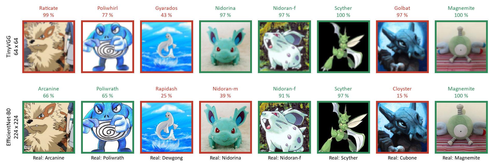
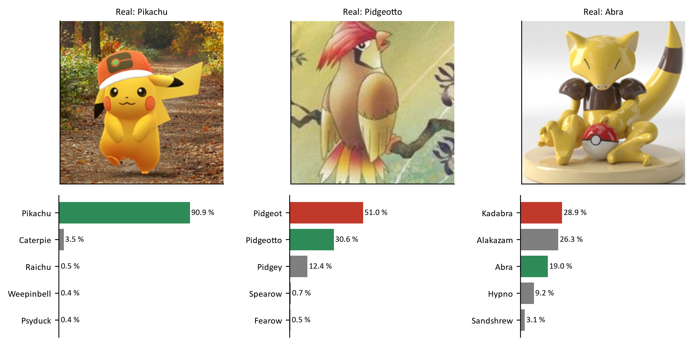
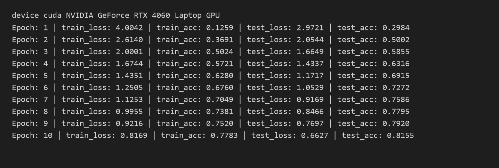

# Actividad 5 · CNN para clasificación de Pokémon

**Materia:** Tópicos Selectos de Grandes Bases de Datos II (NRC 176456)
**Profesor:** Mtro. Iván Alejandro Toledano Juárez
**Alumno:** Carlos Pulido Rosas

📄 **Informe:** [Actividad5_TopicosGBDII_CarlosPulidoRosas.pdf](Actividad5_TopicosGBDII_CarlosPulidoRosas.pdf)

Trabajé sobre el proyecto [IvTole/Pokemon_Classification](https://github.com/IvTole/Pokemon_Classification).
Entrené TinyVGG y el modelo de transferencia de aprendizaje con EfficientNet-B0 en mi computadora
(GPU RTX 4060), con el mismo código, arquitectura e hiperparámetros del repositorio. Los pesos
entrenados se guardan en `models/` (no se suben porque pesan; se generan al correr el entrenamiento).

## Resultados

| Experimento | Exactitud en prueba | Top-5 |
|---|---|---|
| E1 TinyVGG como en el repositorio, 10 épocas | 85.3 % | 96.7 % |
| E2 TinyVGG sin las imágenes de prueba en el entrenamiento, con aumento de datos, 30 épocas | 57.5 % | 79.8 % |
| E3 Igual que E2 pero sin aumento de datos | 42.5 % | 65.2 % |
| E4 EfficientNet-B0 preentrenada, capas convolucionales congeladas, 5 épocas | 77.7 % | 92.2 % |

- `get_data.py` copia las 15 imágenes de prueba de cada especie en lugar de moverlas, así que el
  modelo también entrena con ellas. En la época 10 la prueba marca 81.6 % con el repositorio original
  y 56.4 % si se quitan del entrenamiento.
- TinyVGG se sobreajusta: la pérdida de prueba es mínima en la época 5 y después sube. Sin aumento de
  datos el entrenamiento llega a 99.8 % y la prueba baja a 42.5 %.
- El 13 x 13 de la capa lineal sale de 64 → 62 → 60 → 30 → 28 → 26 → 13. El 93.6 % de los
  1,745,943 parámetros de TinyVGG están en esa capa.
- EfficientNet-B0 entrena solo 193,431 parámetros y desde la primera época supera a TinyVGG. Sus
  diez confusiones más frecuentes son entre Pokémon de la misma línea evolutiva.

## Los modelos clasificando

Predicciones sobre imágenes de prueba que los modelos no vieron, con los pesos guardados después del
entrenamiento (verde = acierto, rojo = error, el porcentaje es la probabilidad de softmax):



Las cinco especies más probables según EfficientNet-B0. Cuando se equivoca suele ser entre etapas
de la misma evolución:



Salida de la consola durante el entrenamiento de E1:



## Archivos

| Archivo | Qué es |
|---|---|
| `Actividad5_TopicosGBDII_CarlosPulidoRosas.pdf` | El informe (entregable) |
| `Actividad5_TopicosGBDII_CarlosPulidoRosas.docx` | El mismo informe en Word |
| `entrenar_actividad5.py` | Entrena los cuatro experimentos. Usa `TinyVGG` y `engine.py` del profesor sin cambios |
| `figuras_actividad5.py` | Hace las gráficas y el análisis por especie |
| `build_actividad5.py` | Arma el informe con la plantilla de la maestría |
| `resultados/resultados.json` | Pérdida y exactitud por época de cada experimento |
| `resultados/figuras/` | Las gráficas del informe |
| `resultados/pred_E*.npz`, `split.json` | Predicciones y probabilidades top-5 sobre la prueba, e índices de las imágenes de prueba |

## Cómo correrlo

Las imágenes no están en el repositorio (pesan casi 1 GB). Las bajé de
[Hugging Face](https://huggingface.co/datasets/sgtsaughter/pokemon-classification-images-151)
porque el de Kaggle pide cuenta, y las descomprimí en `3er-semestre/topicos-selectos-ii/datos/pokemon/PokemonData/`.

```bash
pip install -r requirements.txt   # PyTorch con CUDA: https://pytorch.org/get-started/locally/
python entrenar_actividad5.py     # unos 18 minutos en la RTX 4060
python figuras_actividad5.py
python build_actividad5.py        # necesita python-docx y LibreOffice
```
